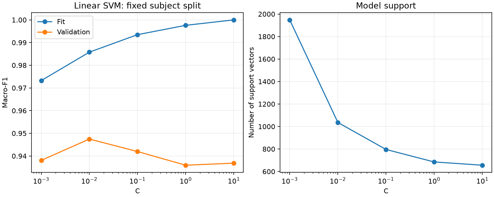

# W10 - Linear SVM on HAR

Run: `python -m experiments.part2_post_midterm.w10_svm`

Fit: 5,270 windows / 15 subjects. Validation: 2,082 windows / 6 disjoint subjects. Official test files are not read.

All 561 features are standardized using fit-only statistics. SVC uses the linear kernel and 15 one-versus-one binary classifiers. Only C varies. No probability calibration or stochastic training is enabled, so repeated seed runs on this fixed split are omitted.

| C | Fit Macro-F1 | Validation Macro-F1 | Validation accuracy | SV count | Fit seconds |
|---:|---:|---:|---:|---:|---:|
| 0.001 | 0.973240 | 0.938075 | 0.944765 | 1948 | 0.459 |
| 0.01 | 0.985773 | 0.947470 | 0.951969 | 1036 | 0.276 |
| 0.1 | 0.993487 | 0.941960 | 0.947166 | 796 | 0.270 |
| 1 | 0.997600 | 0.935936 | 0.940922 | 685 | 0.313 |
| 10 | 1.000000 | 0.936840 | 0.941883 | 656 | 0.394 |



Selected C: 0.01, by validation Macro-F1 (smaller C breaks exact ties). This is a tuning result on one holdout, not an unbiased final-test score.

## Selected-model confusion matrix

Rows = true, columns = predicted; order: WALKING, WALKING_UPSTAIRS, WALKING_DOWNSTAIRS, SITTING, STANDING, LAYING.

```text
[[380   5   1   0   0   0]
 [  0 317   0   0   0   0]
 [ 17  42 221   0   0   0]
 [  0   1   0 334   4   0]
 [  0   0   0  23 352   0]
 [  0   2   0   5   0 378]]
```

Largest directed confusion: WALKING_DOWNSTAIRS -> WALKING_UPSTAIRS: 42 windows.

## Five error examples

First five errors in original validation row order, not cherry-picked.

| Source row | Subject | True | Predicted |
|---:|---:|---|---|
| 67 | 1 | LAYING | WALKING_UPSTAIRS |
| 71 | 1 | LAYING | WALKING_UPSTAIRS |
| 126 | 1 | WALKING_DOWNSTAIRS | WALKING_UPSTAIRS |
| 145 | 1 | WALKING_DOWNSTAIRS | WALKING |
| 381 | 3 | SITTING | STANDING |

## Checks and interpretation

A separate binary example verifies dual-score reconstruction, dual box/equality constraints, and a small primal-dual gap. For every HAR run, the 15 pairwise scores match explicit Xw+b; all solvers converge. These checks verify the experiment's interpretation of sklearn outputs, not execution parity with the upstream CVXOPT implementation.

Increasing C penalizes hinge loss more heavily relative to the norm penalty. It need not improve validation accuracy. The widths in audit.json are the 15 pairwise canonical widths in standardized coordinates, not a single multiclass margin. Support-vector counts are unique across pairs. Model byte counts include selected fitted arrays only, not serialization or process memory.

Quantitative comparison is restricted to this subject split. Correlated overlapping windows are not independent trials; no significance claim is made. Fit times are single-run wall-clock measurements with numerical thread pools limited to one. Kernel/RBF comparison is reserved for W11.
