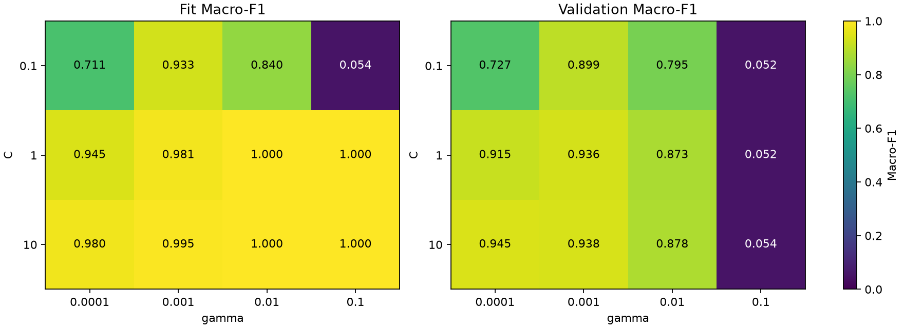

# W11 - Kernel SVM on HAR

Run: `python -m experiments.part2_post_midterm.w11_kernel_svm`

2026-11-09. Fixed grid specified before execution: C={0.1,1,10}, gamma={0.0001,0.001,0.01,0.1}.

Same 5,270 fit / 2,082 validation windows and 15/6 disjoint subjects as W10. StandardScaler fits only the fit rows; all 561 features remain. Official test files are not read. Probability calibration is disabled; SVC uses 15 one-versus-one classifiers.

## RBF sensitivity

| C | gamma | Fit F1 | Validation F1 | Accuracy | SV |
|---:|---:|---:|---:|---:|---:|
| 0.1 | 0.0001 | 0.711174 | 0.727117 | 0.780019 | 5084 |
| 0.1 | 0.001 | 0.933373 | 0.898956 | 0.908742 | 3687 |
| 0.1 | 0.01 | 0.839527 | 0.794721 | 0.782421 | 4527 |
| 0.1 | 0.1 | 0.054143 | 0.052020 | 0.184918 | 5270 |
| 1 | 0.0001 | 0.945218 | 0.914590 | 0.924111 | 3280 |
| 1 | 0.001 | 0.981223 | 0.935534 | 0.941402 | 1914 |
| 1 | 0.01 | 0.999657 | 0.872799 | 0.872719 | 3577 |
| 1 | 0.1 | 1.000000 | 0.052020 | 0.184918 | 5270 |
| 10 | 0.0001 | 0.979674 | 0.944692 | 0.950528 | 1611 |
| 10 | 0.001 | 0.994858 | 0.938253 | 0.942843 | 1349 |
| 10 | 0.01 | 1.000000 | 0.877744 | 0.878002 | 3582 |
| 10 | 0.1 | 1.000000 | 0.053831 | 0.185879 | 5270 |



Selected RBF: C=10, gamma=0.0001; highest validation Macro-F1, with smaller C then gamma breaking exact ties.

## Same-split comparison

| Model | Validation F1 | Accuracy | Fit seconds | Predict seconds |
|---|---:|---:|---:|---:|
| RBF SVM | 0.944692 | 0.950528 | 0.543 | 0.838 |
| Linear SVM (W10 selection) | 0.947470 | 0.951969 | 0.358 | 0.203 |
| GaussianNB (fixed smoothing) | 0.722378 | 0.736311 | 0.030 | 0.045 |
| Majority baseline | 0.052020 | 0.184918 | 0.000 | 0.000 |

GaussianNB is a fresh sklearn baseline with fixed var_smoothing=1e-9, not a reproduction of all W06 tuning. Majority class is learned from fit labels. Linear C is the W10 selection; its validation predictions are reproduced exactly. RBF has 12 candidates versus five W10 linear candidates, so tuning budgets differ. HMM uses sequence context and is not included in this independent-window ranking.

## Selected RBF errors

Rows=true, columns=predicted; labels 1-6 follow WALKING, UPSTAIRS, DOWNSTAIRS, SITTING, STANDING, LAYING.

```text
[[380   6   0   0   0   0]
 [  0 317   0   0   0   0]
 [ 17  52 211   0   0   0]
 [  0   1   0 334   4   0]
 [  0   0   0  21 354   0]
 [  0   2   0   0   0 383]]
```

First five errors in source-row order:

| Row | Subject | True | Predicted |
|---:|---:|---|---|
| 67 | 1 | LAYING | WALKING_UPSTAIRS |
| 71 | 1 | LAYING | WALKING_UPSTAIRS |
| 126 | 1 | WALKING_DOWNSTAIRS | WALKING_UPSTAIRS |
| 145 | 1 | WALKING_DOWNSTAIRS | WALKING |
| 381 | 3 | SITTING | STANDING |

## Verification and limits

Pinned reference hashes pass. Executed upstream RBF helpers agree with sklearn pairwise kernels. Small Gram matrices are symmetric, have unit diagonal, and pass a numerical PSD check; this is a check of these matrices, not a general kernel proof. An explicit polynomial feature map matches the lecture kernel. Binary dual-score reconstruction, alpha box/equality constraints, and precomputed-kernel parity pass for all four gamma values. The upstream CVXOPT solver was not executed.

All HAR SVC fits converge. This is deterministic fitting on one fixed split, so repeated training seeds are not used. The protocol seed list is not treated as five independent datasets. Timings are single-run wall-clock values with numerical thread pools limited to one; core model array bytes are not total process memory.

Results are validation-selected and reuse a holdout examined in earlier weeks; they are not unbiased final-test estimates. Overlapping windows are correlated. RBF distances depend on scaling. High gamma localizes similarity and can overfit; higher C need not improve validation performance. No significance or universal model-ranking claim is made. The historical test exposure recorded in the project remains unchanged.
